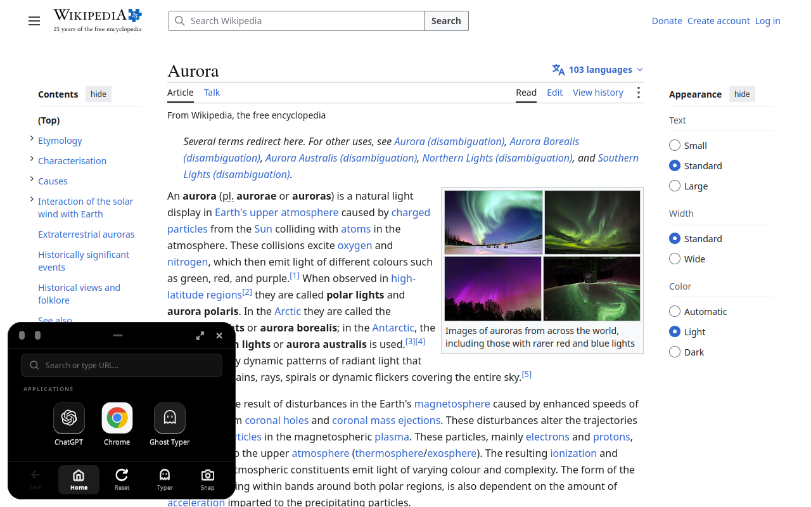

# 📱 Cronq

**A tiny phone-shaped window that floats on top of everything — even fullscreen apps — and never steals your typing focus.**



*Cronq (bottom-left) open on top of a fullscreen browser page. The page behind it keeps keyboard focus.*

---

## 🚀 Install

### 🪟 Windows

**Supported versions**

| Windows version | Supported |
| :--- | :---: |
| Windows 11 (64-bit) | ✅ |
| Windows 10 version 2004 (build 19041) or newer, 64-bit | ✅ |
| Windows 10 older than 2004, Windows 7/8, 32-bit | ❌ |

No admin rights needed. The installer downloads the Microsoft Edge WebView2 runtime for you if it is missing.

**How to install**
1. Open the [latest release](https://github.com/savenXD/Linux-Handy-overlay/releases/latest).
2. Download **`cronq-setup.exe`** and double-click it.
3. If Windows SmartScreen warns you (the build is unsigned), click **More info → Run anyway**.
4. Open a new terminal and type `cronq`, or press **Alt + X** after it starts.

Prefer one command? In PowerShell:
```powershell
irm https://github.com/savenXD/Linux-Handy-overlay/releases/latest/download/cronq-setup.exe -OutFile $env:TEMP\cronq-setup.exe; & $env:TEMP\cronq-setup.exe
```

> ⚠️ The Windows port is **beta**. It passes cross-build and Wine tests but is not fully verified on real Windows yet. See [windows/PARITY.md](windows/PARITY.md).

<details><summary>Build from source (Windows)</summary>

Needs Git, CMake and Visual Studio Build Tools with the C++ workload.
```powershell
git clone https://github.com/savenXD/Linux-Handy-overlay.git cronq; cd cronq
cmake -S windows -B windows/build -A x64
cmake --build windows/build --config Release
powershell -NoProfile -ExecutionPolicy Bypass -File windows/installer/make-dist.ps1
powershell -NoProfile -ExecutionPolicy Bypass -File windows/installer/install.ps1
```
More details: [windows/README.md](windows/README.md).
</details>

**Uninstall:** use *Apps & features*, or run `windows/installer/uninstall.ps1` (add `-Purge` to also delete settings).

---

### 🐧 Linux

**Supported systems**

| Item | Supported |
| :--- | :--- |
| Distros | Linux Mint, Ubuntu, Debian, Fedora, Arch, Manjaro, openSUSE and similar |
| Display server | **X11 / Xorg only** (Wayland is not supported) |
| Desktop | Cinnamon, XFCE, MATE, GNOME, KDE and others, on X11 |

On Ubuntu or Fedora, pick **"on Xorg"** from the gear icon on the login screen.

**How to install** (one command)
```bash
git clone https://github.com/savenXD/Linux-Handy-overlay.git cronq && cd cronq && ./install.sh
```
The script detects your distro, installs what is missing (with your permission), builds Cronq, adds it to your app menu and starts it. Then run `cronq` any time.

**Uninstall:** `./uninstall.sh` (add `--purge` to also remove saved logins and cache).

<details><summary>Manual install (Linux)</summary>

```bash
# Ubuntu / Debian / Mint
sudo apt install -y build-essential pkg-config libgtk-3-dev libwebkit2gtk-4.1-dev \
  libx11-dev libxi-dev libxext-dev libxrandr-dev libxtst-dev xdotool xclip maim
# Fedora
sudo dnf install -y gcc make pkgconf-pkg-config gtk3-devel webkit2gtk4.1-devel \
  libX11-devel libXi-devel libXtst-devel libXrandr-devel libXext-devel xdotool xclip maim
# Arch / Manjaro
sudo pacman -S --needed base-devel gtk3 webkit2gtk-4.1 libx11 libxi libxtst libxrandr libxext xdotool xclip maim

make && make install
```
</details>

---

## Features and shortcuts — 1.5.0

Cronq contains Home and ChatGPT with a saved login. The standalone Browser and Ghost
Typer are removed; Home looks like a compact “page unavailable” error. Double-click **recovery** in the message to open ChatGPT. Mouse click-through (Alt+G) stays.

**Alt+M changes the typing destination.** Gray ball means your normal app receives
text. Green glowing ball means only the overlay receives text. Your desktop app
keeps OS focus. Alt+X hides the overlay while typing continues in the selected
field, with no idle timeout. Alt+M, clicking outside, locking or resetting returns
to normal. Enabling ghost mode sets opacity to 50%. The old Mirror/Exclusive modes are removed.

| Shortcut | Action |
| --- | --- |
| Alt+X | Show / hide |
| Alt+M | Normal app / overlay-only typing |
| Alt+G | Mouse click-through |
| Alt+A / Alt+S | Less / more opaque |
| Alt+F | Fullscreen / restore |
| Alt+D | Fit default dimensions to monitor work area |
| Alt+P | Screenshot without overlay, to clipboard and saved PNG |
| Alt+C | Solid / Camouflage |
| Alt+T | Light / dark, or black / white Camouflage text |
| Alt+Left / Alt+Right | Dock bottom-left / bottom-right and remember |
| Alt+K | Hide and lock shortcuts |
| Alt+K+X | Unlock and show |
| Alt+Shift+K | Uninstall prompt: Enter removes Cronq and all data, Escape cancels |

While hidden, only show/hide, screenshot, lock/unlock and kill-switch shortcuts stay
global. The kill prompt expires after 15 seconds visible or 5 seconds hidden.
Alt+W is removed. Linux intentionally excludes Windows God-copy/God-paste and the
Alt+O / Alt+Shift+O capture experiments.

Appearance switches the native UI and ChatGPT together. Modes are Dark, Light,
Camouflage black text (default) and Camouflage white text. The typing ball remains
visible in Camouflage. Drag the top handle to move, double-click it to maximize
height, and drag the lower-right corner to resize. Home is compact; ChatGPT expands
within the monitor work area. Home shows a 404 message without ChatGPT branding. The header keeps only the keyboard and ghost dots; drag its empty area to move the window. Appearance, fullscreen and hide remain available through shortcuts.
The footer has four tiny low-contrast dots with large click areas, 2px markers near the bottom edge and no hover effects. Left to right they run Back, Home, Reset and Snap; accessible names remain Previous, Overview, Reload and Report. Status messages no longer appear as bubbles. Reset retains your login.

```bash
cronq                     # open / bring up
cronq --mode overlay      # route typing to overlay
cronq --mode normal       # return typing to normal app
cronq status              # visibility, destination, lock and appearance
cronq snap                # screenshot
cronq --version           # same version on Linux and Windows
cronq update              # manual, verified stable-release update
cronq kill                # clean exit
cronq --help
```

Linux requires Python3 for the optional updater. Release archives are built on
Ubuntu24.04 (glibc2.39); use a source build on older distributions. An update does
not change your saved login/settings. Failed processes recover with bounded
backoff, and native crash reports retain the latest three files.

## Configuration and data

Linux settings: `~/.config/cronq/config.ini`, data/login/screenshots:
`~/.local/share/cronq/` (XDG overrides supported). Windows settings:
`%APPDATA%\cronq\config.ini`. Existing Linux profile paths are retained.

```ini
[General]
width = 360
height = 640
margin = 12
corner = bottom-left
monitor = primary
opacity = 1.0
start_visible = false

[Hotkeys]
toggle_key = x
mode_key = m
ghost_key = g
snap_key = p

[Appearance]
mode = 2

[Snap]
snap_scope = monitor
snap_delay_ms = 80
snap_save = true
snap_keep_count = 20
```

Apply changes with `cronq --reload-config`. The optional `[ChatGPT] allowlist`
controls permitted authentication/navigation hosts; legacy ChatGPT allowlists
are retained. Old Browser, GhostWriter and default-key-mode settings are ignored.

## Platform limits and development

Linux requires X11 and a compositor for transparent Camouflage. X11 offers no
secure per-window capture exclusion: the existing capture guard hides after
capture is detected, with a possible first-frame gap. Keyboard grabs keep OS focus
in the normal app, but X11 clients can detect grab notifications; held keys across
a toggle, complex IMEs and raw-input games need desktop-specific testing.
Windows uses WebView2 and its native capture/input APIs. Live login/file upload,
protected capture and secure/elevated apps require actual platform testing.

Build Linux with `make`. `make test` runs real WebKitGTK/X11 tests on a disposable
Xephyr display/profile, plus CLI, screenshot, crash and updater checks. Test
requirements include Xephyr, dbus-run-session, xdotool and xsetroot; a parent
X display is required (`xvfb-run -a make test` works in CI). No test confirms the
kill switch or changes your installed app. Linux release packaging:
`bash scripts/make-linux-dist.sh`.

See the [shared behavior contract](shared/spec/behavior.md),
[Linux parity report](LINUX_PARITY.md), and
[Windows verification report](windows/PARITY.md) for evidence and platform differences.
