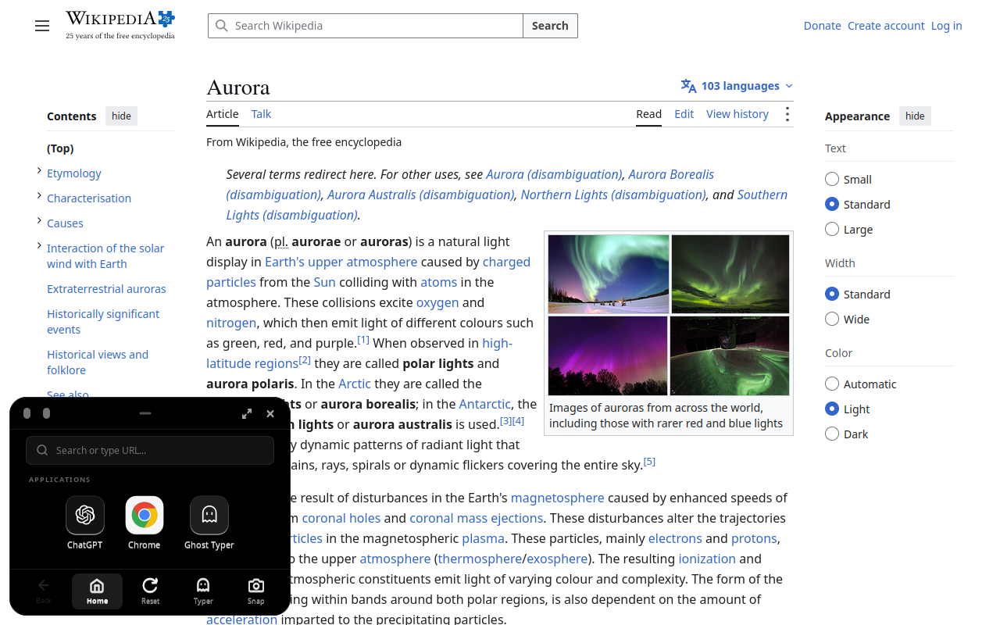

# 📱 Cronq

**A tiny phone-shaped window that floats on top of everything — even fullscreen apps — and never steals your typing focus.**



*Cronq (bottom-left) open on top of a fullscreen browser page. The page behind it keeps keyboard focus.*

---

## 🚀 Install

### 🪟 Windows

**Supported versions**

| Windows version | Supported |
| :--- | :---: |
| Windows 11 (64-bit) | ✅ |
| Windows 10 version 2004 (build 19041) or newer, 64-bit | ✅ |
| Windows 10 older than 2004, Windows 7/8, 32-bit | ❌ |

No admin rights needed. The installer downloads the Microsoft Edge WebView2 runtime for you if it is missing.

**How to install**
1. Open the [latest release](https://github.com/savenXD/Linux-Handy-overlay/releases/latest).
2. Download **`cronq-setup.exe`** and double-click it.
3. If Windows SmartScreen warns you (the build is unsigned), click **More info → Run anyway**.
4. Open a new terminal and type `cronq`, or press **Alt + X** after it starts.

Prefer one command? In PowerShell:
```powershell
irm https://github.com/savenXD/Linux-Handy-overlay/releases/latest/download/cronq-setup.exe -OutFile $env:TEMP\cronq-setup.exe; & $env:TEMP\cronq-setup.exe
```

> ⚠️ The Windows port is **beta**. It passes cross-build and Wine tests but is not fully verified on real Windows yet. See [windows/PARITY.md](windows/PARITY.md).

<details><summary>Build from source (Windows)</summary>

Needs Git, CMake and Visual Studio Build Tools with the C++ workload.
```powershell
git clone https://github.com/savenXD/Linux-Handy-overlay.git cronq; cd cronq
cmake -S windows -B windows/build -A x64
cmake --build windows/build --config Release
powershell -NoProfile -ExecutionPolicy Bypass -File windows/installer/make-dist.ps1
powershell -NoProfile -ExecutionPolicy Bypass -File windows/installer/install.ps1
```
More details: [windows/README.md](windows/README.md).
</details>

**Uninstall:** use *Apps & features*, or run `windows/installer/uninstall.ps1` (add `-Purge` to also delete settings).

---

### 🐧 Linux

**Supported systems**

| Item | Supported |
| :--- | :--- |
| Distros | Linux Mint, Ubuntu, Debian, Fedora, Arch, Manjaro, openSUSE and similar |
| Display server | **X11 / Xorg only** (Wayland is not supported) |
| Desktop | Cinnamon, XFCE, MATE, GNOME, KDE and others, on X11 |

On Ubuntu or Fedora, pick **"on Xorg"** from the gear icon on the login screen.

**How to install** (one command)
```bash
git clone https://github.com/savenXD/Linux-Handy-overlay.git cronq && cd cronq && ./install.sh
```
The script detects your distro, installs what is missing (with your permission), builds Cronq, adds it to your app menu and starts it. Then run `cronq` any time.

**Uninstall:** `./uninstall.sh` (add `--purge` to also remove saved logins and cache).

<details><summary>Manual install (Linux)</summary>

```bash
# Ubuntu / Debian / Mint
sudo apt install -y build-essential pkg-config libgtk-3-dev libwebkit2gtk-4.1-dev \
  libx11-dev libxi-dev libxext-dev libxrandr-dev libxtst-dev xdotool xclip maim
# Fedora
sudo dnf install -y gcc make pkgconf-pkg-config gtk3-devel webkit2gtk4.1-devel \
  libX11-devel libXi-devel libXtst-devel libXrandr-devel libXext-devel xdotool xclip maim
# Arch / Manjaro
sudo pacman -S --needed base-devel gtk3 webkit2gtk-4.1 libx11 libxi libxtst libxrandr libxext xdotool xclip maim

make && make install
```
</details>

---

## ⭐ Major Features

# 🛡️ NO FULL-SCREEN APP CAN STOP IT
Cronq stays **on top of fullscreen games, fullscreen videos, and borderless-fullscreen apps**. It keeps itself above them and re-raises itself if something tries to bury it.

# 🎯 NEVER STEALS FOCUS
Click, scroll and type in the overlay while your editor, game or terminal stays the active window.

# 👻 GHOST MODE (CLICK-THROUGH)
Press **Alt + G** and every click passes straight through the overlay to whatever is behind it.

# ⌨️ GHOST TYPER (HUMAN-LIKE TYPING)
Paste text, pick Slow / Moderate / Fast, press Start, and Cronq types it into the app you clicked, with human-like timing and optional "extra safe" typos that get corrected.

# 📸 CLEAN SCREENSHOTS
**Alt + P** hides the overlay for a split second, captures the screen without it, saves the image and copies it to your clipboard.

# 🌐 BUILT-IN MOBILE BROWSER + CHATGPT
A phone-sized browser and ChatGPT, with logins that stay saved between sessions.

# 🔍 SEE-THROUGH, RESIZABLE, MOVABLE
Change opacity, drag it anywhere, resize it, or go fullscreen.

# 🔒 PANIC BUTTONS *(Windows)*
**Alt + K** instantly hides the overlay and locks all other shortcuts. **Alt + K + X** unlocks. **Alt + Shift + K** is a kill switch that removes Cronq from the PC after you confirm.

---

## ⌨️ Shortcuts

All shortcuts work globally while holding **Alt**.

| Shortcut | What it does |
| :--- | :--- |
| **Alt + X** | Show / hide the overlay |
| **Alt + G** | Ghost mode (click-through) on / off |
| **Alt + A** / **Alt + S** | Less / more opaque |
| **Alt + F** | Fullscreen on / off |
| **Alt + D** | Back to default size (360×640) |
| **Alt + P** | Clean screenshot |
| **Alt + M** | Typing mode: Mirror ⇄ Exclusive |
| **Alt + W** | Start / cancel Ghost Writer |
| **Alt + C** | Camouflage on / off (transparent, text only) |
| **Alt + T** | Text colour: black ⇄ white (Light ⇄ Dark when not camouflaged) |
| **Alt + ←** / **Alt + →** | Dock bottom-left / bottom-right (remembered) |
| **Alt + K** · **Alt + K + X** | Lock (hide + disable all shortcuts) · Unlock |
| **Alt + Shift + K** | Kill switch: Enter removes Cronq and all its data, Esc cancels |

**Appearance:** the top-left button cycles Dark → Light → Camo; the choice is saved under `[Appearance] mode` (0 Dark, 1 Light, 2 Camo black text *(default)*, 3 Camo white text). Camouflage needs a compositing window manager. Hiding the overlay from screen recorders is Windows-only: X11 has no per-window capture exclusion.

**Mouse:** drag the top handle to move, drag the bottom-right corner (or edges on Windows) to resize. The bottom bar has Back, Home, Reset, Typer and Snap.

**Command line**
```bash
cronq            # open / bring to front
cronq toggle     # show or hide
cronq status     # current state
cronq snap       # screenshot
cronq kill       # quit
cronq --help     # everything else
```

**Mirror vs Exclusive:** in *Mirror* your keystrokes go to both the overlay and the app behind it. In *Exclusive* they go only to the overlay.

---

## 🧰 Tech Stack

| | Linux | Windows |
| :--- | :--- | :--- |
| **Language** | C (GNU11) | C++17 |
| **Window / UI** | GTK 3 + Cairo | Win32 |
| **Browser engine** | WebKitGTK 4.1 | Microsoft Edge WebView2 |
| **Stay-on-top, global keys** | X11 / Xlib, XInput2 | Win32 topmost + low-level keyboard hook |
| **Click-through** | XShape | Win32 layered windows |
| **Typing injection** | XTest | SendInput |
| **Build** | Make | CMake, Inno Setup (installer) |
| **CLI ↔ overlay** | Unix domain socket | Local IPC |

Both versions follow one shared behavior spec: [shared/spec/behavior.md](shared/spec/behavior.md). Memory use is low (under about 60 MB on Linux).

---

## ⚠️ What It Can't Do

- **Wayland:** pure Wayland blocks global shortcuts, click-through and always-on-top. Use an X11 session.
- **Exclusive-fullscreen / kernel anti-cheat games:** apps that take over the display exclusively, and games with kernel-level protection, can still hide it.
- **Complex IMEs** (e.g. Japanese, Chinese candidate popups) may need *Exclusive* mode.
- **Phone-sensor checks:** sites that test for real phone hardware can tell it is an embedded browser.

---

## ⚙️ Configuration

Linux: `~/.config/cronq/config.ini` · Windows: `%APPDATA%\cronq\config.ini`

```ini
[General]
width = 360
height = 640
corner = bottom-left      # bottom-left, bottom-right, top-left, top-right
opacity = 0.98
start_visible = false
default_key_mode = mirror # mirror or exclusive

[Browser]
home_url = https://html5test.com
search_url_template = https://duckduckgo.com/?q=%s

[Hotkeys]
toggle_key = x
ghost_key = g
snap_key = p
mode_key = m
ghost_writer_key = w
```
Apply changes without restarting (Linux): `cronq --reload-config`.

---

## 🧪 Development

- Linux tests live in [tests/](tests/) (for example `bash tests/test_ghost_page.sh` in a dedicated X11 test display such as Xephyr).
- Windows details, test checklist and parity report: [windows/README.md](windows/README.md), [windows/PARITY.md](windows/PARITY.md).
- History: [DEVLOG.md](DEVLOG.md).
